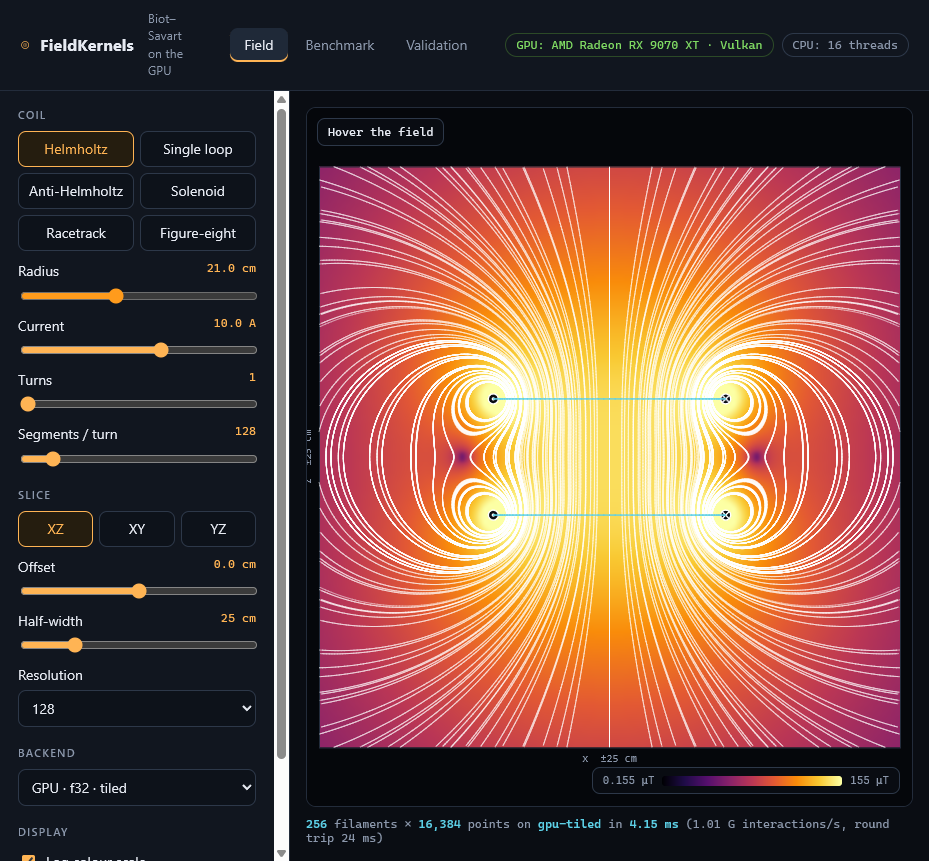
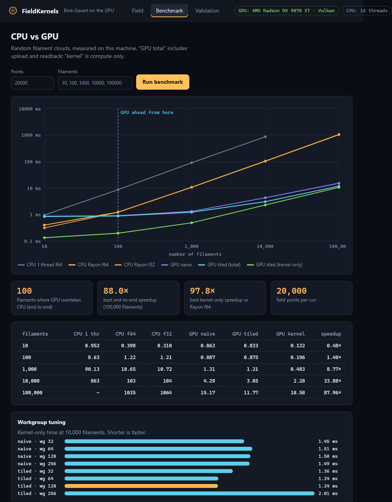

# FieldKernels

Biot–Savart magnetic fields of current-carrying coil filaments, computed on the GPU.

* **Rust core** – exact analytic field of straight segments, evaluated by
  * a multithreaded **Rayon** CPU kernel (`f64` and `f32`), and
  * cross-platform **wgpu / WGSL** compute kernels (`f32`; Vulkan, Metal, DX12), in a naive and a shared-memory *tiled* variant.
* **Python bindings** (PyO3 + maturin) with a NumPy interface and a pure-NumPy reference.
* **Local web app** – interactive field slices, field lines, a live CPU-vs-GPU benchmark and a validation report. One binary, no Node, no build step.
* **Validation suite** – every kernel is checked against closed-form solutions (see below).



## Run the frontend (30 seconds)

You need a Rust toolchain ([rustup.rs](https://rustup.rs)). A GPU is optional; without one the CPU backends are used.

```sh
git clone <this repo> && cd FieldKernels
cargo run --release -p fieldkernels-cli -- serve --open
```

Then open <http://127.0.0.1:8080> (`--open` does it for you; `--port N` changes the port).

* **Field** tab: pick a coil (Helmholtz, anti-Helmholtz, solenoid, racetrack, figure-eight, single loop), drag the sliders, switch backend. Field lines are traced client-side; ⊙/⊗ mark where the wire pierces the slice. Hover for the local **B**.
* **Benchmark** tab: sweeps the filament count on this machine, reports the CPU/GPU **crossover**, speedups and a workgroup-size sweep.
* **Validation** tab: runs the correctness suite.

> **Windows note:** the default MSVC toolchain just works if Visual Studio Build Tools are installed. With the `x86_64-pc-windows-gnu` toolchain you need MinGW (`dlltool`, `gcc`) on `PATH`, installed in a path **without spaces**.

### Command line

```sh
cargo run --release -p fieldkernels-cli -- info
cargo run --release -p fieldkernels-cli -- validate
cargo run --release -p fieldkernels-cli -- bench --points 20000 --csv bench.csv
cargo test --release
```

## Python

```sh
python -m venv .venv && source .venv/bin/activate      # Windows: .venv\Scripts\activate
pip install maturin numpy pytest
maturin develop --release
pytest python/tests
python examples/python_demo.py
```

```python
import numpy as np, fieldkernels as fk

starts, ends, I = fk.loop_filaments([0, 0, 0], [0, 0, 1], radius=0.1, n=512, current=10.0)
pts = np.random.uniform(-0.2, 0.2, (100_000, 3))

B64 = fk.biot_savart(pts, starts, ends, I, backend="cpu")                 # f64, Rayon, tesla
Bg  = fk.biot_savart(pts, starts, ends, I, backend="gpu", kernel="tiled", workgroup_size=128)
```

`backend` is `"cpu"`, `"gpu"`, `"numpy"` or `"auto"`. Arrays are `(N, 3)` float64; segment `k` runs `starts[k] → ends[k]` carrying `currents[k]` amperes.

## Method

For a straight segment `a → b` with `dl = b − a`, `r₁ = p − a`, `r₂ = p − b`, `c = dl × r₁`:

```
B = (μ₀ I / 4π) · c / |c|² · ( dl·r₁/|r₁| − dl·r₂/|r₂| )
```

This is exact for a straight wire, so a coil's error is only how well segments approximate the wire. Points within ~1e-6·|dl| (f64) or ~1e-4·|dl| (f32) of a segment's line skip that segment, because the field diverges on the wire.

GPU details: one thread per field point; the **tiled** kernel stages `WG` filaments at a time into workgroup memory so each global load is reused `WG` times. Coordinates are recentred on the scene before casting to `f32`, and sums are blocked (per 64 filaments / per tile) to reduce accumulated rounding. 2-D dispatch and chunking handle more than 65 535 workgroups and more than 1 M points.

## Results

Measured on the development machine (AMD Radeon RX 9070 XT via Vulkan, 16 CPU threads, Windows 11, release build, 20 000 field points, median of 3). Reproduce with `fieldkernels bench`; yours will differ.

| filaments | CPU 1 thread f64 | CPU Rayon f64 | GPU tiled (total) | GPU kernel only | speedup (total) |
|---:|---:|---:|---:|---:|---:|
| 10 | 0.95 ms | 0.40 ms | 0.83 ms | 0.13 ms | 0.48× |
| 100 | 8.6 ms | 1.22 ms | 0.88 ms | 0.20 ms | 1.4× |
| 1 000 | 90 ms | 10.7 ms | 1.21 ms | 0.48 ms | 8.8× |
| 10 000 | 863 ms | 103 ms | 3.05 ms | 2.28 ms | 33.9× |
| 100 000 | – | 1035 ms | 11.8 ms | 10.6 ms | 88× |

* **Crossover:** below ~100 filaments the multithreaded CPU is faster (upload/launch latency dominates); from ~100 filaments the GPU wins end to end.
* **Throughput:** CPU Rayon ≈ 2 G filament-point interactions/s; GPU kernel ≈ 170–190 G/s.
* **Workgroup tuning** (30 000 filaments, kernel only): tiled is fastest at workgroup 64–128 (3.5 ms), ~15 % ahead of naive (≈4.1 ms, flat across sizes); tiled at 256 is slowest (4.9 ms).



## Validation

`fieldkernels validate` (also in `cargo test`, and the **Validation** tab). Errors are measured on this machine:

| check | max relative error | tolerance |
|---|---:|---:|
| CPU f64 vs **exact** regular-polygon on-axis field (200 cases) | 1.0e-15 | 1e-12 |
| CPU f32 vs exact polygon | 6.4e-7 | 1e-4 |
| circular loop vs **elliptic-integral** solution, 8192 chords, 500 points | 5.3e-7 | 2e-6 |
| long wire vs μ₀I/2πd | 3.1e-8 | 1e-6 |
| ∇·B = 0 by central differences | 3.9e-7 | 1e-6 |
| CPU f32 vs CPU f64, 5 coil types, 23 000 points | 4.8e-5 | 1e-4 |
| GPU naive / tiled (f32) vs CPU f64, 5 coil types, 23 000 points | 3.5e-5 | 1e-4 |
| GPU tiled, ragged sizes (777 points, 1001 segments, wg 256) | 1.3e-5 | 1e-4 |

The loop-vs-analytic error is chord discretisation, not arithmetic: halving the chord length (4096 → 8192) cut it 4× (2.1e-6 → 5.3e-7). The polygon check isolates arithmetic error, and f64 reaches machine precision. For the coil comparisons the error is `|ΔB| / max(|B_ref|, 1e-3·max|B|)`, so points where the true field nearly cancels do not dominate.

## Limitations

* **GPU precision is `f32` only.** WGSL has no portable `f64`. Use the CPU `f64` path when you need double precision.
* No CUDA backend; wgpu targets Vulkan/Metal/DX12 (and GL), which covers NVIDIA, AMD, Intel and Apple GPUs.
* Filaments are straight segments with a constant current; there is no finite-conductor-thickness model.
* Hosted CI runners have no GPU, so GPU tests skip themselves there; run `cargo test --release` locally to exercise them.

## Layout

```
crates/fieldkernels-core   kernels, geometry, analytic references, validation, benchmark harness
crates/fieldkernels-cli    `fieldkernels` binary: serve / bench / validate / info
crates/fieldkernels-py     PyO3 extension (built by maturin, not part of default cargo build)
frontend/                  static web app (embedded into the binary)
python/                    Python package + tests
.github/workflows/ci.yml   Rust (3 OSes) and Python CI
```

## License

MIT
